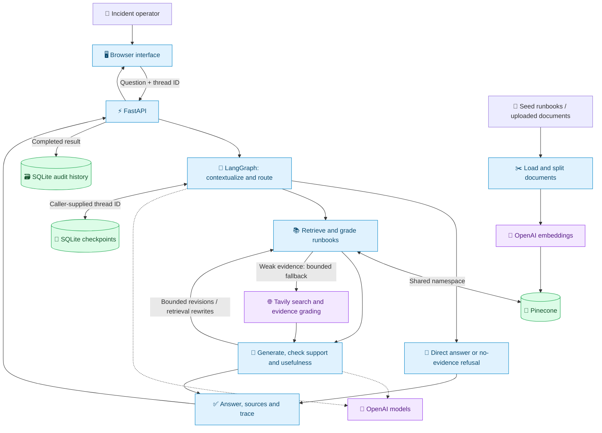

# CloudOps Sentinel: Enterprise Incident Response Self-RAG Copilot

An AI copilot for investigating cloud incidents with operational runbooks, corrective retrieval, and persistent conversation context. The application combines **LangGraph**, **Pinecone**, **OpenAI**, and **FastAPI** to turn incident questions into answers grounded in retrieved evidence.

## Engineering capabilities

- **Self-correcting retrieval:** grade document relevance, rewrite weak queries, and evaluate answer support and usefulness.
- **Knowledge ingestion:** load PDF, TXT, Markdown, and DOCX files, split them into chunks, and index them with stable identifiers.
- **Stateful workflows:** preserve incident context across follow-up questions with LangGraph and SQLite checkpoints.
- **Search fallback:** use Tavily when internal retrieval does not provide sufficient evidence.
- **Application integration:** connect chat, document uploads, audit history, and a browser interface through FastAPI.
- **Deployment packaging:** provide a Dockerfile and environment-based service configuration.

## Architecture



Component overview grounded in `app.py`, `src/self_rag.py`, `src/ingestion.py`
and `src/db.py`. Retry branches are grouped for readability. External services
in this diagram are integration points; credential-free tests use doubles.

## Tech stack

- **LangGraph**: Self-RAG workflow, conditional routing, persistent thread state
- **OpenAI `gpt-5-mini`**: routing, query rewriting, generation, relevance grading, IsSUP and IsUSE
- **OpenAI `text-embedding-3-large`**: embeddings for private operational documents
- **Pinecone**: private runbooks/SOPs/postmortems knowledge base
- **Tavily**: controlled internet-search fallback
- **SQLite**: LangGraph persistence memory + incident audit storage
- **FastAPI**: application/API backend
- **HTML/CSS/JavaScript**: incident-command-center UI with document upload
- **Docker**: deployment packaging

## Project structure

```text
CloudOps-Sentinel-Enterprise-Incident-Response-Self-RAG-Copilot/
├── app.py
├── data_ingestion.py          # ONE file to build the Pinecone KB
├── src/
│   ├── config.py
│   ├── db.py
│   ├── ingestion.py
│   ├── models.py
│   ├── self_rag.py
│   └── vectorstore.py
├── documents/                 # initial private knowledge documents
│   ├── checkout-api-runbook.md
│   ├── payments-high-cpu-runbook.md
│   └── deployment-rollback-sop.md
├── templates/index.html
├── static/styles.css
├── static/app.js
├── uploads/                   # temporary request-local ingestion staging
├── data/                      # SQLite persistence files
├── requirements.txt
├── Dockerfile
└── .env.example
```

## 1. Setup

```bash
python -m venv venv
```

Windows:

```bash
venv\Scripts\activate
```

macOS/Linux:

```bash
source venv/bin/activate
```

Install dependencies:

```bash
pip install -r requirements.txt
```

Copy `.env.example` to `.env` and configure:

```env
OPENAI_API_KEY=...
PINECONE_API_KEY=...
TAVILY_API_KEY=...
```

The defaults are:

```env
OPENAI_MODEL=gpt-5-mini
EMBEDDING_MODEL=text-embedding-3-large
EMBEDDING_DIMENSION=3072
PINECONE_INDEX_NAME=cloudops-sentinel-openai-self-rag
PINECONE_NAMESPACE=incident-runbooks
```

> The project intentionally uses a new default Pinecone index name. The earlier local embedding version used a different vector dimension, and Pinecone index dimensions cannot be mixed.

## 2. Build the entire Pinecone knowledge base with ONE command

Put your initial PDF/TXT/MD/DOCX documents inside `documents/`, then run:

```bash
python data_ingestion.py
```

That one file performs the complete ingestion pipeline:

```text
Read .env
  ↓
Create / validate Pinecone index
  ↓
Load ./documents
  ↓
Split documents into chunks
  ↓
OpenAI text-embedding-3-large
  ↓
Upsert to Pinecone
  ↓
Configured namespace is ready
```

The ingestion uses stable chunk IDs, so rerunning the script updates matching vectors rather than blindly generating a new random ID for every chunk.

## 3. Run the application

Either:

```bash
python app.py
```

or:

```bash
uvicorn app:app --reload
```

Open:

```text
http://127.0.0.1:8000
```

## Add new documents from the UI

The left-side **Runbook Vault** accepts:

- PDF
- TXT
- Markdown
- DOCX

When you click **Add to knowledge base**, the backend uses the exact same ingestion layer and OpenAI embedding model as `data_ingestion.py`.

```text
New UI Document
      ↓
FastAPI /api/upload
      ↓
Document Loader + Chunking
      ↓
OpenAI Embeddings
      ↓
EXISTING Pinecone Index
      ↓
EXISTING Namespace
```

New runbooks can be added through the interface without using a separate ingestion workflow.

## LangGraph SQLite persistence memory

Every browser incident session has a persistent `thread_id`. The LangGraph workflow is compiled with a SQLite checkpointer and stores checkpoints in:

```text
data/langgraph_memory.sqlite
```

Example incident conversation:

**Question 1**

> Our checkout API is returning 502 errors after deployment. What should I check first?

**Question 2**

> What should I check next if that doesn't work?

For the second message, the `contextualize` node uses the persisted incident context and converts the follow-up into a standalone operational question before continuing through Self-RAG.

SQLite provides local persistence. A production deployment would require a separate review of storage, concurrency, authentication, and operational controls.

## Example workflows

### A: Existing Pinecone knowledge

Ask:

> Our checkout API is returning 502 errors after deployment. What should the on-call engineer check first?

Expected route: **Private Runbooks**.

### B: Persistent memory

Immediately ask:

> What should I check next if that does not work?

The same `thread_id` should reuse the previous incident context.

### C: Upload new operational knowledge

Upload a new PDF/MD/DOCX from the UI. The status will show how many chunks were added to the existing namespace. Then ask a question whose answer exists only in the newly uploaded document.

### D: Internet-search fallback

Ask about a technical issue that is not covered by any private runbook. Self-RAG first tries the private KB, grades the evidence, rewrites if necessary, and then transitions to **Internet Search** when internal evidence remains insufficient.

## Important configuration rule

The application and ingestion script both import `src/vectorstore.py`. That means they always use the same:

- OpenAI embedding model
- embedding dimension
- Pinecone index
- Pinecone namespace

This prevents a common RAG mistake where offline ingestion and runtime retrieval use different embeddings or different namespaces.

## Validation status

Run credential-free checks with Python 3.11 or 3.12:

```bash
python -m pip install -r requirements-dev.txt
python -m pip check
python -m unittest discover -s tests -v
```

The API tests import the real app and use in-process HTTP requests and disposable
SQLite audit databases. Model execution and upload ingestion are replaced with
test doubles. They cover chat validation and audit persistence, page/assets/health,
upload bounds, concurrent same-name staging, and cleanup on success and failure.
GitHub Actions runs the same checks on Python 3.11 and 3.12.

Uploads accept PDF, TXT, MD and DOCX. `MAX_UPLOAD_BYTES` defaults to 10485760
(10 MiB), with a supported range of 1 to 104857600 bytes. Empty files return 400;
files over the limit return 413 before ingestion. Each upload uses a separate
temporary directory, preserves the basename for chunk identity, and removes its
staged file after ingestion, including failure paths. Files already in `uploads/`
are left in place. Backend chat/ingestion errors return a generic message and are
logged on the server.

The staging limit is applied after multipart parsing. Configure a request-body
limit at the deployment proxy as well. It does not bound extracted text, provider
writes, or concurrent requests. Same-name requests cannot overwrite staging files,
but may still update the same vector IDs. A failed ingestion may leave partial
provider writes. Source metadata may refer to a staging path that no longer exists;
the document basename remains available for citations.

Workflow tests execute the compiled LangGraph with real disposable SQLite
checkpoints and deterministic model, retriever and search doubles. They verify
reopened checkpoint history, thread separation, contextualized follow-up retrieval,
per-turn state reset, source citations, direct/internal/web/refusal routes, provider
failure without a completed memory turn, and bounded revisions and searches.
These tests verify control flow and persistence, not model judgment quality.

`MAX_SUPPORT_RETRIES`, `MAX_RETRIEVAL_REWRITES` and `MAX_WEB_REWRITES` accept
integers from 0 to 5, defaulting to 2. Support retries count answer revisions;
internal rewrites are additional retrievals after the first attempt. Web rewrites
count total search attempts, so zero disables web fallback. The graph step limit
scales with these budgets. If support remains partial or absent after the revision
budget, the workflow returns **No Reliable Evidence** before usefulness grading.
A refusal clears abandoned sources and usefulness labels. Direct general-knowledge
answers bypass evidence grading by design. `used_web_search` records entry into
the web-search path, including when the search key is missing.

Checkpoint memory is keyed only by the caller-supplied thread ID. Thread
separation is not authorization: anyone who knows an ID can reuse its history.
Tests use sequential calls; simultaneous requests for the same thread, checkpoint
retention, production database recovery and multi-worker behavior remain unverified.
Provider failures can leave intermediate checkpoints, but do not add a completed
conversation turn; a new invocation resets transient state.

Ingestion tests use the real UTF-8, DOCX and PDF loaders (including a two-page
text-bearing PDF fixture) and real recursive text splitter. They cover metadata,
800-character chunks and overlap, stable IDs across staging directories, changed
content IDs, empty extraction without provider calls, directory filtering/order,
and propagated setup/upsert failures. Index creation, dimension mismatch,
namespace and retriever configuration use service doubles. A partial-write double
shows retries reuse IDs; it does not prove Pinecone rollback or deduplication.
Changing or shortening a document does not delete its older vectors. Same-name,
same-content documents share IDs by design; there is no document-version catalog.

### Container verification

GitHub Actions builds the runtime image and runs it as UID 10001 with no provider
keys. The build context allows only runtime files, seed Markdown runbooks and
source/license attribution. CI plants dummy environment files and verifies they
are absent in `/app`, checks writable `data/` and `uploads/`, imports the ingestion
entry point, then starts the actual image with `PORT=8090`. Real HTTP probes check
health, page, assets and an empty SQLite audit table, including an on-disk query.
Health is a process probe, not a check of provider connectivity.

Reproduce with a running Docker daemon:

```bash
docker build -t incident-response:local .
docker run --rm --name incident-smoke -e PORT=8090 -p 127.0.0.1:8090:8090 incident-response:local
# In another terminal:
python3 scripts/smoke_http.py http://127.0.0.1:8090
```

The smoke script expects a fresh, empty audit database and invokes no providers.
For persistence, mount writable directories at `/app/data` and `/app/uploads`,
owned by UID/GID 10001. Pass provider configuration using runtime environment
variables or `--env-file`; environment files are not packaged in the image.
Dependencies have broad version ranges, so builds are not locked or reproducible
across dates. The image uses Python 3.11; Python 3.12 is also tested outside Docker.

Live OpenAI/Pinecone/Tavily calls, real embedding/vector writes, browser interaction
and deployed end-to-end behavior remain unverified. The API has no authentication
and audit history is shared. This completes the three planned credential-free
segments; production controls and live-provider validation remain separate work.
See the [delivery plan](docs/delivery-plan.md) for scope and limits.

I learned from Bappy Ahmed, whose original work is MIT-licensed, through Krish Naik Academy.
